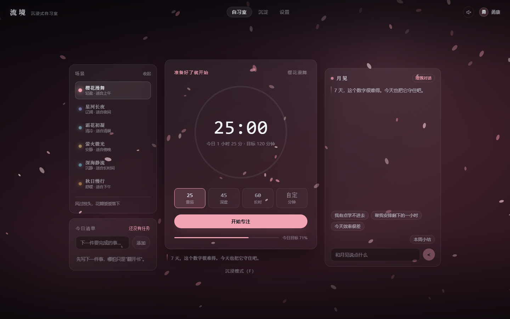
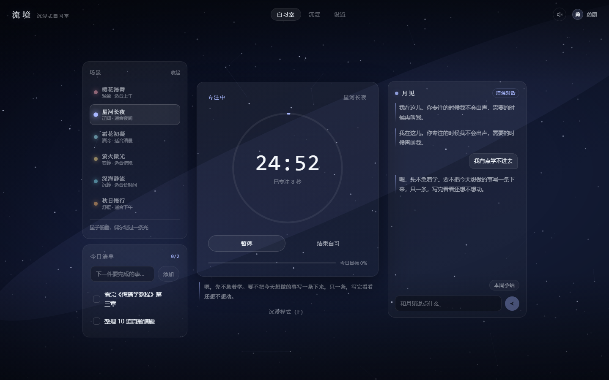
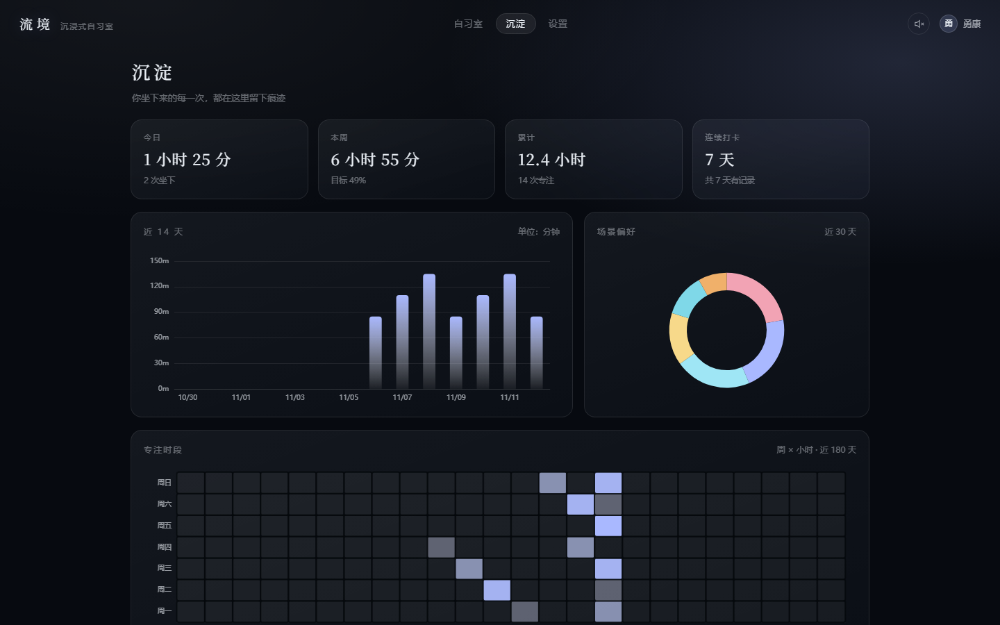

# 流境 · 沉浸式流动自习室

> 一个"看得见氛围、陪得了情绪、留得下数据"的线上自习室。
> 毕业设计：《基于 Vue 的沉浸式流动自习室系统的设计与实现（融入 AI 陪伴智能体）》

- **产品设计文档**：`docs/产品设计文档.md`
- **技术方案**：`docs/技术方案.md`
- **项目档案（唯一真相源）**：`PROJECT.md`

## 界面预览

| 自习室 · 樱花慢舞 | 自习室 · 星河长夜 + 月见对话 | 沉淀 · 统计与热力图 |
|---|---|---|
|  |  |  |

## 功能总览

| 模块 | 内容 |
|---|---|
| 用户 | 注册 / 登录（JWT + bcryptjs）、个人资料、学习偏好 |
| 自习核心 | 番茄钟 / 自定义倒计时、任务清单、开始/暂停/结束、**标签页标题实时同步** |
| 沉浸场景 | 6 个 Canvas 流动场景（樱花/星河/霜花/萤火/深海/秋日）、环境音效（Web Audio 合成）、沉浸模式 |
| 数据沉淀 | 每次自习入库、日/周/月统计、连续打卡、专注时段热力图、成就徽章 |
| 月见 AI | 规则语库保底（零依赖）+ 大模型增强（上下文注入 + SSE 流式），双轨自动切换 |

## 快速开始

依赖：Node.js ≥ 22（使用了内置 `node:sqlite`，本地默认零依赖直跑，无需安装数据库）。

```bash
# 1. 后端（端口 3000，首次启动自动建表）
cd backend
npm install
npm run dev

# 2. 前端（端口 5173，已配置 /api 代理）
cd frontend
npm install
npm run dev
```

打开 http://localhost:5173 ，注册即可使用。

> 日常使用建议后端用 `npm start`（不带 `--watch`）：`npm run dev` 会监听源码，Windows 上偶发无关文件事件会让服务自动重启，重启窗口内的保存请求会返回 500。开发改代码时再用 `npm run dev`。

## 切换 MySQL 8（答辩 / 部署）

编辑 `backend/.env`（参考 `.env.example`）：

```ini
DB_DRIVER=mysql
DB_HOST=127.0.0.1
DB_PORT=3306
DB_USER=root
DB_PASSWORD=你的密码
DB_NAME=liujing
```

建库后执行迁移（幂等）：

```bash
cd backend
mysql -u root -p -e "CREATE DATABASE IF NOT EXISTS liujing DEFAULT CHARSET utf8mb4"
npm run migrate
```

> 表结构与索引见 `backend/src/db/schema.mysql.sql`；DAO 为手写 SQL，无 ORM。

## 启用月见大模型增强（可选，按账号配置）

月见默认走**规则语库保底**，项目本身**不内置任何 Key**。每个用户登录后在「设置 → 月见 · 大模型」填入自己的 OpenAI 兼容协议 Key，即可对自己的账号启用增强对话（上下文注入 + SSE 流式打字机）：

- **按账号隔离**：Key 存在各用户自己的数据行里（`user_llm_keys` 表），用户之间互相不可见、不可用、不可删对方的记录；
- **历史记录**：每次保存生成一条历史（最多保留 10 条，新→旧），最新一条为生效配置；可按条删除，删掉生效那条会自动回落到上一条，全部删光则回到规则语库；
- **Key 安全**：明文只存在后端数据库，任何接口（含本人）都只返回打码值（如 `sk-ab****abcd`）；
- **测试连接**：验证的是输入框里尚未保存的配置，可先测再存；
- `backend/.env` 中的 `LLM_BASE_URL` / `LLM_MODEL` 仅作为新用户保存时的接口地址与模型推荐默认值，不再是任何人生效的 Key。

## 测试

```bash
cd backend   && npm test   # Supertest 接口测试 + 纯函数测试
cd frontend  && npm test   # Vitest：计时算法 / 标题同步 / 格式化 / 徽章
```

## 目录结构

```
├─ docs/                 产品设计文档 + 技术方案
├─ backend/
│  ├─ src/
│  │  ├─ routes/         auth / sessions / stats / ai
│  │  ├─ dao/            手写 SQL（mysql2 + node:sqlite 双驱动）
│  │  ├─ middleware/     JWT 闸 / 统一错误 / 轻量校验
│  │  ├─ ai/             语库(保底) + prompt + llm代理(增强) + 双轨 service
│  │  └─ db/             连接管理 + schema.mysql.sql / schema.sqlite.sql
│  └─ tests/             Supertest + Vitest
├─ frontend/
│  ├─ src/
│  │  ├─ scenes/         engine.js 粒子引擎 + 6 个场景（统一 init/update/resize/destroy 协议）
│  │  ├─ stores/         user / session(计时权威源) / scene / yuejian
│  │  ├─ views/          Login / Register / StudyRoom / Stats / Settings
│  │  ├─ components/     计时器 / 任务清单 / 月见面板 / 图表等
│  │  └─ utils/          时间戳计时 / 标题同步 / 徽章 / Web Audio 音效 / ECharts 按需
│  └─ tests/
└─ .workbuddy/e2e/       本地浏览器验收脚本（可选）
```

## 关键实现纪律（对应技术方案 3.2）

1. **Canvas 粒子数据不进响应式**：粒子数组为普通对象，`engine.js` 用 rAF 直接绘制；Vue 只管理场景 ID、音效开关等低频状态。
2. **倒计时权威源在前端 session store**：全部由时间戳差值计算，`setInterval` 只负责推动重绘，后台节流不漂移。
3. **后端时长回算校验**：入库时长以起止时间戳差值为准（容忍 ±60s），前端上报值仅做一致性校验，防脏数据。
4. **Key 只在后端**：每位用户的月见 API Key 存在该用户自己的数据库行里（用户间隔离），前端与接口只接触打码值，真实请求由后端代理完成。

## 本地端到端验收（可选）

`node .workbuddy/e2e/check2.mjs`（需本机 Edge + 已启动前后端），自动走完注册 → 造数 → 自习 → 统计 → 移动端全流程并截图到 `.workbuddy/shots/`。
